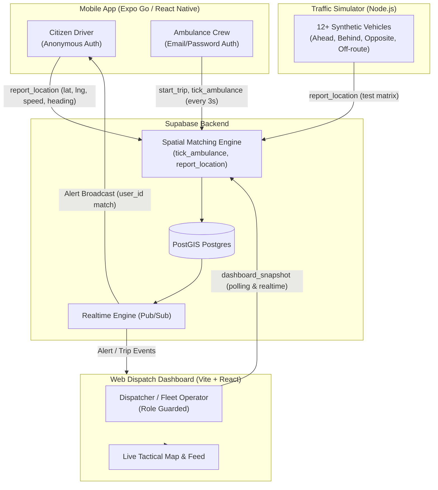

# Emergency Path Clearing (Path Clear)

A real-time emergency corridor alert and dispatch telemetry system that warns drivers who are directly in the forward path of an oncoming ambulance so they can move aside before sirens can even be heard.

---

## 🏗️ Architecture



---

## 📐 Corridor Alert Logic in Plain Language

When an emergency ambulance transmits its location fix (every 3 seconds), the database matching function evaluates all active driver positions against the road route:

1. **Lateral Corridor (30 meters)**: The driver must be within 30 meters of the ambulance's planned road route polyline (`ST_DWithin(route, geom, 30)`). Vehicles on adjacent parallel roads are ignored.
2. **Lookahead Window (1 kilometer)**: Only vehicles situated **ahead** of the ambulance along the route direction, up to a maximum distance of 1,000 meters, qualify for alerts. Vehicles behind the ambulance are skipped or cleared.
3. **Heading Alignment (±60° tolerance)**: The vehicle's heading must match the ambulance's forward heading within 60 degrees (or travel at < 3 km/h where compass orientation fluctuates). Vehicles traveling in the opposite direction on the opposite lane are excluded.
4. **Blocking Detection (< 8 km/h)**: Any vehicle matching the corridor traveling slower than 8 km/h (or completely stopped in traffic) is classified with `blocking = true`, triggering a severe high-urgency alert.

---

## 🚀 Setup & Installation

### Step 0: Supabase Project Setup
1. Create a project at [supabase.com](https://supabase.com).
2. Go to **Database > Extensions**: enable `postgis` and `pg_cron`.
3. Go to **Authentication > Providers**:
   - Turn **ON** "Allow anonymous sign-ins".
   - Turn **ON** Email provider and turn **OFF** "Confirm email".
4. Open **SQL Editor**:
   - Run `supabase/supabase_schema.sql`
   - Run `supabase/002_dashboard.sql`
5. Go to **Authentication > Users > Add user**:
   - Create `ambulance1@test.com` with a password.
   - Create `dispatcher1@test.com` with a password.
6. In **Table Editor > profiles**:
   - Change `ambulance1@test.com` profile `role` to `ambulance`.
   - Change `dispatcher1@test.com` profile `role` to `dispatcher`.
7. In **Project Settings > API**:
   - Copy Project URL and Publishable (anon) key.
8. Sign up at [openrouteservice.org](https://openrouteservice.org) for a free directions API key.

---

### Environment Configuration

#### 1. Mobile (`mobile/.env`)
```bash
cp mobile/.env.example mobile/.env
```
Fill in:
```ini
EXPO_PUBLIC_SUPABASE_URL=https://your-project.supabase.co
EXPO_PUBLIC_SUPABASE_PUBLISHABLE_KEY=your-publishable-key
EXPO_PUBLIC_ORS_API_KEY=your-openrouteservice-key
EXPO_PUBLIC_DEFAULT_LAT=51.505
EXPO_PUBLIC_DEFAULT_LNG=-0.09
```

#### 2. Web Dashboard (`web/.env`)
```bash
cp web/.env.example web/.env
```
Fill in:
```ini
VITE_SUPABASE_URL=https://your-project.supabase.co
VITE_SUPABASE_PUBLISHABLE_KEY=your-publishable-key
VITE_DEFAULT_LAT=51.505
VITE_DEFAULT_LNG=-0.09
```

#### 3. Simulator (`tools/simulator/.env`)
```bash
cp tools/simulator/.env.example tools/simulator/.env
```
Fill in:
```ini
SUPABASE_URL=https://your-project.supabase.co
SUPABASE_PUBLISHABLE_KEY=your-publishable-key
DISPATCHER_EMAIL=dispatcher1@test.com
DISPATCHER_PASSWORD=your-dispatcher-password
```

---

## 🏃 Running the Applications

### Supabase Backend Verification & CLI
```bash
cd supabase
npm install
npm run test:connection   # Verifies live Supabase Auth, RLS, and RPCs
```

### Mobile App (Expo Go)
```bash
cd mobile
npm install
npx expo start -c
```
Open with the **Expo Go** app on your physical device or simulator.

### Web Dispatch Dashboard
```bash
cd web
npm install
npm run dev
```
Open [http://localhost:5173](http://localhost:5173) in your browser.

### Test Simulator Tool
```bash
cd tools/simulator
npm install
node simulate.mjs
```

---

## 👥 Roles & Test Accounts

| Role | Auth Mechanism | Credentials | Capabilities |
|---|---|---|---|
| **Citizen Driver** | Anonymous auth | Automatic upon tapping "I'm a driver" | Reports foreground GPS, receives full-screen audio/haptic corridor alerts, acknowledges move-aside. |
| **Ambulance Crew** | Email + Password | `ambulance1@test.com` | Plans destination & road route, creates trip, broadcasts live 3s ticks, simulate drive mode. |
| **Dispatcher** | Email + Password | `dispatcher1@test.com` | Monitors tactical live map, fleet counters, alert feed, and trip history on web console. |

---

## ⚖️ Free-Tier Limits (Supabase)
- **Realtime Connections**: 200 concurrent connections, 2 million messages/month.
- **Database Size**: 500 MB storage cap.
- **Project Pause**: Free projects automatically pause after 7 days of inactivity (prevented by the included `.github/workflows/keepalive.yml` ping workflow).
- **Backups**: Daily automatic backups are not included on the free plan.

---

## ⚠️ Known Limitations
- **Foreground Tracking**: Location telemetry runs strictly in the foreground while the mobile screen remains active.
- **GPS Lane Resolution**: Consumer phone GPS typically offers 3–5m accuracy, sufficient for 30m road corridors but not specific lane discernment.
- **Ecosystem Reach**: Corridor alerts reach drivers running the application; vehicles without the app rely on audible sirens.

---

## 🔒 Privacy Architecture
- **Zero Location History**: No journey trajectories or past coordinates are stored in the database.
- **Single Row Overwrite**: Each citizen holds exactly one row in `vehicle_locations`, completely replaced on each telemetry ping.
- **Ephemeral Auto-Deletion**: Any fix older than 2 minutes is automatically purged and excluded from queries.
- **User Right to Erasure**: Citizens can tap "Delete my data and sign out" on the privacy screen to immediately erase their record.
